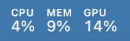

# MyStat

**Fast, free, lightweight Mac stats. Right in your menu bar.**

MyStat is a small native Swift/SwiftUI monitor with AppKit/Core Graphics charts for Apple Silicon. CPU activity, memory pressure, and GPU activity stay visible at a glance. Click for the details, then get back to what you were doing.

A native app with no accounts, subscriptions, analytics, or privileged helper. Sparkle is bundled for optional signed updates; automatic checks are off by default. Free to use, change, and share under the [MIT license](LICENSE).

**Built for Apple Silicon, with macOS 27 as the primary target and macOS 26 support retained.** The 0.2.2 candidate passed actual-app visual checks on macOS 27.0.1 and 26.6, plus a one-hour memory soak on an M5 Pro MacBook Pro running macOS 27.0.1. See [current testing and results](docs/testing/2026-10-17-core-graphics-charts.md). macOS 27 power-sensor mappings remain experimental; these checks do not establish independent sensor accuracy. Earlier hardware reports, including an M5 MacBook Air, are recorded [separately](docs/testing/2026-10-12-hardware.md).

**Support policy for 0.2.2:** macOS 27 is the primary target. macOS 26 remains supported until macOS 28 is released. Releases are qualified on both supported versions; hardware-validation limits still apply.

[Download the latest release](https://github.com/ballardcm/mystat/releases/latest) · [Install](INSTALL.md) · [Contribute](CONTRIBUTING.md) · [Report an issue](https://github.com/ballardcm/mystat/issues)

For suspected security vulnerabilities, follow the [private reporting instructions](SECURITY.md).

## A closer look

Actual menu bar capture on macOS 26:



<p>
  
  
</p>

Actual app captures on an M5 Pro running macOS 26. Readings vary with workload. The screenshots contain only MyStat's interface.

- **CPU:** total activity and a bar for every logical core.
- **Memory:** pressure in the menu bar; used percentage, app/wired/compressed breakdown, and swap in the dropdown. Low pressure can coexist with lots of allocated RAM.
- **GPU:** device activity, renderer/tiler activity, and unified-memory usage.
- **Thermals and power:** CPU/GPU temperatures, component power estimates, whole-Mac power, and fan speeds where available.
- **Small by design:** two-second sampling by default, bounded in-memory history, no background subprocess polling, and sampling pauses during sleep. The dropdown view is released when closed.
- **Your choice:** 1/2/5-second sampling, pause, optional launch at login, and opt-in daily update checks. The dropdown shows the running version.

Click outside, press Escape, click the menu-bar item again, or use × to close. Right-click the menu-bar item for pause and quit.

## Install

Download the `MyStat-<version>-macos-arm64.zip` asset from the [latest release](https://github.com/ballardcm/mystat/releases/latest), unzip it, move `MyStat.app` into an Applications folder you own, and open it. Look in the menu bar; there is no Dock icon.

Starting with **0.2.0, official releases are Developer ID signed and notarized by Apple**. See [installation instructions](INSTALL.md) for checksum verification, updating, uninstalling, and guidance for older ad-hoc releases. You can also build from source below.

## Build from source

Use an Apple Silicon Mac with macOS 26 or 27, a compatible Apple Swift/Clang toolchain, and Python 3. Version 0.2.2 was built with full Xcode 27.1 and the macOS 27.0 SDK. Select Xcode as the active developer directory; the standalone Command Line Tools installation tested on macOS 27 lacked the required SwiftUI macro plugin. Homebrew and GCC are unnecessary. The first build downloads a pinned, checksum-verified Sparkle framework from its official GitHub release; later builds reuse that archive. No dependency installation is required for users.

```sh
# After installing Xcode and completing its first-launch setup:
sudo xcode-select --switch /Applications/Xcode.app/Contents/Developer

git clone https://github.com/ballardcm/mystat.git
cd mystat
./scripts/build.sh
./scripts/test.sh
open build/MyStat.app
```

The first release was built with Swift 6.3.3 and the macOS 26.5 SDK, and tested on macOS 26.6. The build uses the active developer directory's default SDK, ignoring an inherited `SDKROOT`. If needed, set `MYSTAT_SDK` to a compatible SDK directory. It produces an arm64 app with an ad-hoc signature in `build/MyStat.app`.

Quit the running copy before opening a rebuilt app. Copy it to Applications before enabling launch at login, so its location remains stable.

Package an ad-hoc test build, including the license, install guide, and SHA-256 checksum:

```sh
./scripts/release.sh --adhoc
```

Ad-hoc test artifacts are written to `dist/adhoc/`, which is excluded from Git. The release script runs the hardware tests, builds the app, checks its signature, and packages only the intended deliverables. Official releases use [Developer ID signing and notarization](docs/SIGNING.md); running `./scripts/release.sh` without `--adhoc` requires the signing identity and notarization Keychain profile and produces an archive only after Apple acceptance and local verification.

## Memory footprint and testing (0.2.2)

Version 0.2.2 replaces the three SwiftUI Canvas charts with AppKit/Core Graphics drawing, preserving the dashboard, readings, 60-sample histories, and sampling options. On an M5 Pro with 48 GB running macOS 27.0.1, matched open-dashboard runs at the default two-second refresh measured:

| Physical memory footprint | Canvas control | 0.2.2 chart implementation |
| --- | ---: | ---: |
| Median over 61 samples | 127.3 MiB | 29.6 MiB |

That is about **77% less memory with the dashboard open** on this configuration. A separate one-hour visible-dashboard soak at the faster one-second refresh recorded a 32.3 MiB median and 33.3 MiB lifetime peak, with no upward trend. Short comparison runs showed no CPU regression. These are measured results on one Mac, not a memory or performance guarantee for every workload.

We also fixed a resource leak: CPU and memory sampling acquired two Mach host send-right references per sample without releasing them. The sampler now owns one reusable reference and releases it when destroyed. This kernel-resource leak was separate from the large chart allocations. Battery caching now retains only scalar readings, temporary sampling objects drain after each sample, and unchanged menu-bar values reuse one cached image.

The ad-hoc UI candidate for 0.2.2 passed the automated suite and updater integration tests, actual-app visual checks on macOS 26.6 and 27.0.1 (light/dark, normal/small displays, resizing while open, settings, pause and dismissal), and 100 open/close cycles on macOS 27 with no material retained-memory growth. Physical sensor availability was smoke-tested; macOS 27 sensor mappings remain experimental. See the [exact candidate, methodology, results, and limitations](docs/testing/2026-10-17-core-graphics-charts.md). These improvements ship in 0.2.2; 0.2.1 used the previous chart renderer.

## Measurements and compatibility

| Reading | Source and meaning |
| --- | --- |
| CPU and cores | Mach processor tick deltas. Busy time averaged across logical cores, not frequency-scaled capacity. The first sample establishes a baseline. |
| Memory used | Mach VM counters: internal minus purgeable, plus wired and physical compressor pages. Reclaimable file cache is excluded. GPU allocations share this pool and must not be added again. |
| Memory pressure | 100 minus the kernel availability percentage, `kern.memorystatus_level`, also exposed by `memory_pressure -Q`. Normal/elevated/critical severity is read separately. This is not the percentage of RAM occupied by apps. |
| GPU | AGX driver statistics. Device, renderer, tiler, and memory in use; no invented per-GPU-core utilization. |
| Temperatures and fans | Read-only AppleSMC counters. Temperatures are the hottest valid reading in each CPU/GPU sensor group; grouping is a heuristic. No fan control or SMC writes. |
| Whole Mac power | SMC system-load reading, with a battery-controller fallback. Includes more than CPU/GPU and is not wall-socket power. |
| Component power on macOS 26 | IOReport energy-counter deltas divided by elapsed monotonic time. Estimates, not laboratory measurements. |

Missing counters display a dash. Invalid units, negative energy deltas, implausible values, and sleep gaps are rejected. Some hardware interfaces are private and may change with macOS updates. CPU and memory collection remain separate from hardware sensor availability.

On an M5 Pro running macOS 27.0.1, CPU usage agreed with macOS `top`, memory pressure matched `memory_pressure -Q`, and CPU power and temperature readings rose under load and fell afterward. This [hardware smoke check](docs/testing/2026-10-12-hardware.md) establishes basic operation on that configuration, not precise sensor accuracy or support across all Apple Silicon Macs. macOS 27 CLPC mappings remain experimental; independent power/temperature validation and sleep/wake testing are still needed. In-app update tests and synthetic mapping tests do not establish physical sensor accuracy.

See [third-party notices](THIRD_PARTY_NOTICES.md) for hardware-interface references and attribution.

## Pull requests welcome

Have a smaller/faster implementation, an accessibility improvement, a bug fix, or readings from another Apple Silicon Mac? **Please open a PR!** Hardware reports should include chip, macOS version, and how you compared the readings. Remove personal data from screenshots and diagnostics.

All changes go through pull requests to `main`, including maintainer changes. [CONTRIBUTING.md](CONTRIBUTING.md) covers the short build/check workflow and project priorities.

## AI disclosure

This project was developed with substantial assistance from OpenAI Codex, including implementation, documentation, and debugging. It has been compiled, exercised on the stated hardware, and checked with focused automated tests, but AI-assisted code can contain mistakes. This is an early release, not an independently audited or Apple-certified tool. Please review the source, verify readings that matter to you, and report problems.

The **app itself does not use AI or send data to an AI service**.

## Optional updates and privacy

Use **Check for Updates…** in the gear or right-click menu, or opt in to **Automatically check for updates** in the gear menu for daily checks. Sparkle displays release notes and offers install/relaunch, remind later, or skip. Automatic downloads and silent installation are disabled. With automatic checks off, MyStat makes no background update requests; a manual check still contacts GitHub.

Update traffic is limited to the signed stable feed on GitHub and release downloads (including GitHub’s download CDN). GitHub receives ordinary request metadata such as IP address and updater User-Agent. MyStat sends no metrics, hardware profile, or analytics. Feed and archive signatures are verified with a pinned Ed25519 public key before use. In-app updates require a user-owned writable installation on macOS 26 or 27; manual installation remains available.

Published 0.1.1 installations need one manual upgrade to 0.1.2 or later to obtain the updater. The signed feed offers the latest compatible stable release. See [updater design and publishing](docs/UPDATES.md) and [release testing](docs/RELEASE_TESTING.md).

## Development notes

`Sources/MyStat` contains the UI and sampler. `Sources/Hardware` contains the small read-only C interfaces. `Tests` checks counter mappings, energy conversion, sampler resource ownership, battery decoding, menu-bar rendering and caching, chart geometry and drawing, dashboard placement, and updater/release behavior.

```sh
build/MyStat.app/Contents/MacOS/MyStat --diagnose
open build/MyStat.app --args --snapshot /tmp/mystat-dark.png
# Quit the running copy before launching a second capture:
open build/MyStat.app --args --snapshot /tmp/mystat-light.png --snapshot-light
```

Diagnostics print one sample and discovered temperature keys. Sandboxed automation may hide counters that work in a normal desktop launch. Snapshot mode renders just the app panel and writes a neighboring JSON sample; ordinary launches do not write snapshots. Keep raw diagnostics and local captures out of commits; only reviewed screenshots belong in `docs/screenshots/`.
