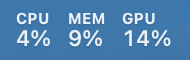
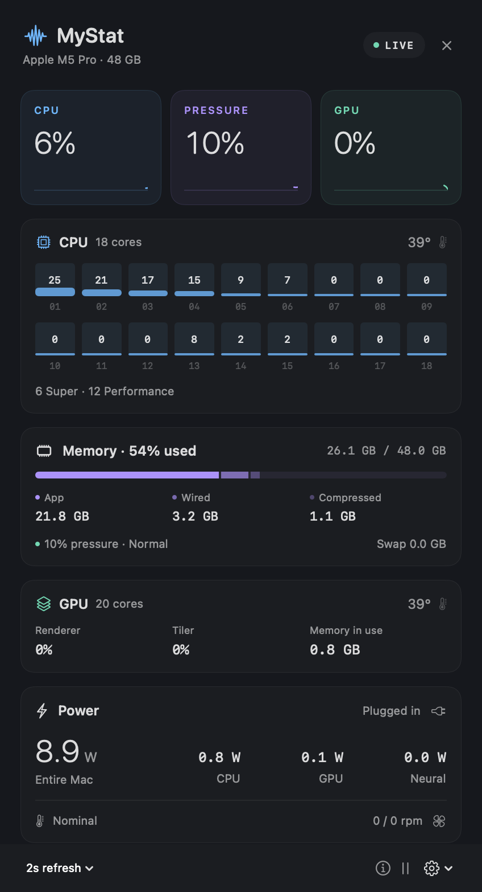
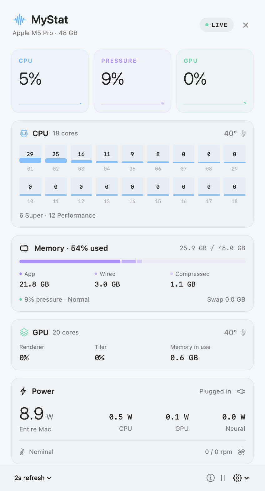

# MyStat

**Fast, free, lightweight Mac stats. Right in your menu bar.**

MyStat is a small native Swift/SwiftUI monitor for Apple Silicon. CPU activity, memory pressure, and GPU activity stay visible at a glance. Click for the details, then get back to what you were doing.

One executable. No package dependencies, accounts, subscriptions, analytics, network requests, or privileged helper. Free to use, change, and share under the [MIT license](LICENSE).

**Built for and tested on macOS 26**, on an M5 Pro MacBook Pro. **macOS 27 support is planned for a later update.** Other chips and OS versions have not yet been hardware-validated; some sensors may be unavailable.

[Download the latest release](https://github.com/ballardcm/mystat/releases/latest) · [Install](INSTALL.md) · [Contribute](CONTRIBUTING.md) · [Report an issue](https://github.com/ballardcm/mystat/issues)

## A closer look

Actual menu bar capture on macOS 26:



<p>
  
  
</p>

Actual app captures on an M5 Pro running macOS 26. Readings vary with workload. The screenshots contain only MyStat's interface.

- **CPU:** total activity and a bar for every logical core.
- **Memory:** pressure in the menu bar; used percentage, app/wired/compressed breakdown, and swap in the dropdown. Low pressure can coexist with lots of allocated RAM.
- **GPU:** device activity, renderer/tiler activity, and unified-memory usage.
- **Thermals and power:** CPU/GPU temperatures, component power estimates, whole-Mac power, and fan speeds where available.
- **Small by design:** two-second sampling by default, bounded in-memory history, no background subprocess polling, and sampling pauses during sleep. The dropdown view is released when closed.
- **Your choice:** 1/2/5-second updates, pause, and optional launch at login.

Click outside, press Escape, click the menu-bar item again, or use × to close. Right-click the menu-bar item for pause and quit.

## Install

Download `MyStat-0.1.0-macos-arm64.zip` from [Releases](https://github.com/ballardcm/mystat/releases), unzip it, move `MyStat.app` into Applications, and open it. Look in the menu bar; there is no Dock icon.

The initial release is **ad-hoc signed, not Developer ID signed or notarized**. macOS may block the first launch. See [installation instructions](INSTALL.md) for Apple's per-app approval steps, checksum verification, updating, and uninstalling. You can also build from source below.

## Build from source

Use an Apple Silicon Mac with macOS 26 and a compatible Apple Swift/Clang toolchain. Xcode Command Line Tools are enough; full Xcode, Homebrew, GCC, and third-party packages are unnecessary.

```sh
# Only if Command Line Tools are not already installed:
xcode-select --install

git clone https://github.com/ballardcm/mystat.git
cd mystat
./scripts/build.sh
./scripts/test.sh
open build/MyStat.app
```

If the first PR is still under review, check out `feat/initial-release` after cloning. `main` starts with an empty bootstrap commit so all application code enters through a PR.

The first release was built with Swift 6.3.3 and the macOS 26.5 SDK, and tested on macOS 26.6. The build uses the active developer directory's default SDK, ignoring an inherited `SDKROOT`. If needed, set `MYSTAT_SDK` to a compatible SDK directory. It produces an arm64 app with an ad-hoc signature in `build/MyStat.app`.

Quit the running copy before opening a rebuilt app. Copy it to Applications before enabling launch at login, so its location remains stable.

Package a release, including the license, install guide, and SHA-256 checksum:

```sh
./scripts/release.sh
```

Artifacts are written to `dist/`, which is excluded from Git. The release script runs the hardware tests, builds the app, checks its signature, and packages only the intended deliverables.

## Measurements and compatibility

| Reading | Source and meaning |
| --- | --- |
| CPU and cores | Mach processor tick deltas. Busy time averaged across logical cores, not frequency-scaled capacity. The first sample establishes a baseline. |
| Memory used | Mach VM counters: internal minus purgeable, plus wired and physical compressor pages. Reclaimable file cache is excluded. GPU allocations share this pool and must not be added again. |
| Memory pressure | 100 minus the kernel availability percentage, `kern.memorystatus_level`, also exposed by `memory_pressure -Q`. Normal/elevated/critical severity is read separately. This is not the percentage of RAM occupied by apps. |
| GPU | AGX driver statistics. Device, renderer, tiler, and memory in use; no invented per-GPU-core utilization. |
| Temperatures and fans | Read-only AppleSMC counters. Temperatures are the hottest valid reading in each CPU/GPU sensor group; grouping is a heuristic. No fan control or SMC writes. |
| Whole Mac power | SMC system-load reading, with a battery-controller fallback. Includes more than CPU/GPU and is not wall-socket power. |
| Component power on macOS 26 | IOReport energy-counter deltas divided by elapsed monotonic time. Estimates, not laboratory measurements. |

Missing counters display a dash. Invalid units, negative energy deltas, implausible values, and sleep gaps are rejected. Some hardware interfaces are private and may change with macOS updates. CPU and memory collection remain separate from hardware sensor availability.

Experimental macOS 27 CLPC mappings are present in the source, but **macOS 27 is not a supported or validated release target yet**. They will be revisited and tested in a later update. The mapping tests validate identifiers and conversions, not real-world readings on macOS 27.

See [third-party notices](THIRD_PARTY_NOTICES.md) for hardware-interface references and attribution.

## Pull requests welcome

Have a smaller/faster implementation, an accessibility improvement, a bug fix, or readings from another Apple Silicon Mac? **Please open a PR!** Hardware reports should include chip, macOS version, and how you compared the readings. Remove personal data from screenshots and diagnostics.

All changes go through pull requests to `main`, including maintainer changes. [CONTRIBUTING.md](CONTRIBUTING.md) covers the short build/check workflow and project priorities.

## AI disclosure

This project was developed with substantial assistance from OpenAI Codex, including implementation, documentation, and debugging. It has been compiled, exercised on the stated hardware, and checked with focused automated tests, but AI-assisted code can contain mistakes. This is an early release, not an independently audited or Apple-certified tool. Please review the source, verify readings that matter to you, and report problems.

The **app itself does not use AI or send data to an AI service**.

## Development notes

`Sources/MyStat` contains the UI and sampler. `Sources/Hardware` contains the small read-only C interfaces. `Tests` checks counter mappings and energy conversion edge cases.

```sh
build/MyStat.app/Contents/MacOS/MyStat --diagnose
open build/MyStat.app --args --snapshot /tmp/mystat-dark.png
# Quit the running copy before launching a second capture:
open build/MyStat.app --args --snapshot /tmp/mystat-light.png --snapshot-light
```

Diagnostics print one sample and discovered temperature keys. Sandboxed automation may hide counters that work in a normal desktop launch. Snapshot mode renders just the app panel and writes a neighboring JSON sample; ordinary launches do not write snapshots. Keep raw diagnostics and local captures out of commits; only reviewed screenshots belong in `docs/screenshots/`.
