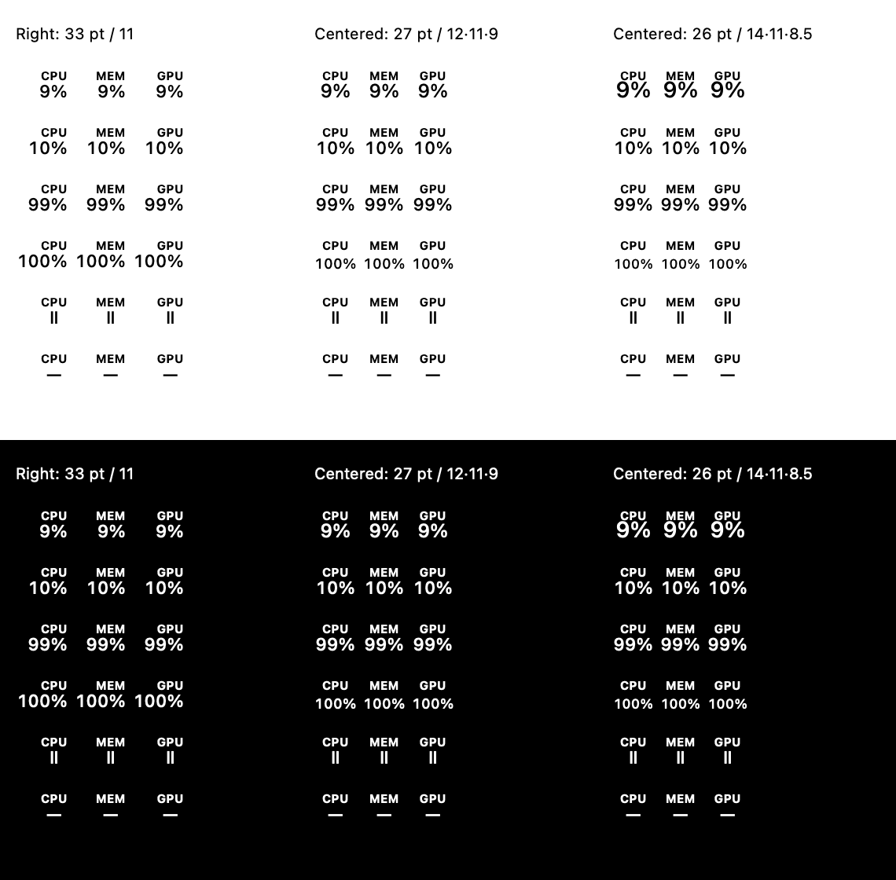

# Compact centered menu-bar validation

Substantial AI assistance: Codex implementation, design exploration, and independent review agents.

## Selected design

The original 33 pt columns and 8 pt gaps used 115 pt. Reducing the gaps to 4 pt and right-aligning captions used 107 pt. The selected design uses fixed 27 pt columns, 4 pt gaps, centered captions and centered values: 89 × 22 pt. One-, two-, and three-digit readings use 12, 11, and 9 pt monospaced-digit fonts respectively. Pause and unavailable symbols use 11 pt. A small vertical offset keeps the value row centered as font sizes change.

The centered version prioritizes common two-digit readings while accommodating rare 100% without reserving the largest font width for every reading. Its width is about 17% smaller than the previous right-aligned candidate. The 14/11/8.5 pt alternative crowded the captions and was rejected. Font size visibly changes at digit boundaries, but column centers and the entire status-item footprint remain fixed.

This comparison is a rendered design fixture, not a screenshot of the shipping app.

## Provenance and automated results

Final code revision: `41495907487fe9b66dd45c09d5c908fe2b9caf51`.

Ad-hoc candidate executable SHA-256: `6cda35e50d3df4c7b57ca3763aff19c0f810cffdbca3eb24f5d29510735a9ecd`. The host and both guest candidates had the same hash. No Developer ID signing, notarization, release, or merge was performed.

- `MYSTAT_SIGN_IDENTITY=- ./scripts/build.sh`: passed.
- `./scripts/test.sh`: passed all suites.
- 343 independent CPU/MEM/GPU combinations of 0%, 9%, 10%, 99%, 100%, paused, and unavailable retained 89 × 22 pt template images.
- At 1× and 2×, caption/value ink stayed centered within 1.5 pt raster tolerance and did not spill into the inter-column gaps.
- `build/menu-bar-tests --live`: passed on the host, macOS 26 VM, and macOS 27 VM. All 56 transitions retained identical status-item window, button screen, and neighboring-item frames after insertion settled. This exercises each column independently and all columns together, forward and backward through digit/state boundaries.

Synthetic data is limited to the test executable and native `--review` fixture; the shipping app has no fake-reading input.

## Actual UI observations

Target VM: macOS 26.6 (25G72), Parallels Desktop 27.0.3 (58680). Experimental VM and host: macOS 27.0.1 (26A434). macOS 27 observations do not establish supported sensor compatibility.

The earlier right-aligned revision `87b8104195afbcdf00f27271debb322879c2ffdf` received an actual macOS 26 app pass in normal and smaller VM windows: dropdown resizing while open, full panel including scrolling to GPU/power, dismissal, light/dark appearance, pause/resume, settings and refresh menus. The dropdown source did not change during the subsequent centered-layout iteration.

For final revision `4149590`, repeated affected checks on the actual macOS 26 candidate: centered live 1-/2-digit values and naturally unavailable GPU, pause/resume, settings menu, light/dark dropdown and toolbar, and opening/dismissing the dropdown at the smaller VM window (2052 × 1126 capture pixels). Enlarging the VM with the dropdown open repositioned it correctly; the settled large display showed the complete panel and footer. The menu bar remained compact and the footer stayed accessible at the smaller size. A native fixture displayed single digits, two digits, 100%, pause and unavailable in the actual guest toolbar; the settled fixture frame was 105 pt wide including AppKit padding. The final macOS 27 fixture also showed clean single and mixed 1-/2-/3-digit values in the actual toolbar; live frame assertions passed there.

Host: the actual candidate dropdown continued showing live hardware data, and the native review fixture was visually inspected in both appearances at 1×/2×. Desktop-wide capture on the host did not expose the menu bar reliably, so host jitter evidence comes from live AppKit frame assertions rather than a claim of a complete visual menu-bar capture.

These are UI/layout checks. VM sensor unavailability is expected and this change does not alter sensor mappings. A complete release-signing visual pass must be repeated before a future signed release. Original installed apps and baseline VMs were preserved; test VMs were restored to their installed apps and stopped. The host is left running the ad-hoc candidate for review.
