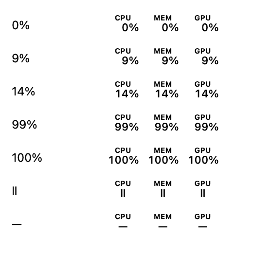

# MyStat 0.2.0 release preparation

Status: **signed and notarized candidates verified; final release qualification in progress**. Developer ID and notarization Keychain setup are complete. No 0.2.0 release or production appcast has been published.

- Candidate: 0.2.0, build 5, branch `release/0.2.0`, based on `36765ee`; includes the fixed-width menu-bar fix for issue #16.
- Host: macOS 27.0.1, build 26A434; Apple Command Line Tools.
- Ad-hoc test ZIP SHA-256: `bddf636e77d7558dad425baceea4ecd12e10c645a55662d45f83a9c0034dc6ea`.
- Artifact: ignored `dist/adhoc/MyStat-0.2.0-macos-arm64.zip`. This is not an official release artifact.

## Passed locally

- Hardware mapping/energy-conversion unit tests; these are synthetic tests, not new physical sensor validation.
- Update selection, trusted URL, version/build, OS, ownership/writability, and recovery tests.
- Four appcast/default-security tests.
- Seven release workflow tests using command fixtures: missing credentials, rejected notarization, upload/staple/assessment failures, accepted-result ordering, resume verification, isolated ad-hoc packaging, and nested hardened-runtime signing arguments. These do not validate real Apple signing or notarization.
- Ad-hoc build/package, strict nested code-signature verification after archive extraction, and ZIP SHA-256 verification.
- Real Sparkle integration suite with disposable app fixtures: automatic checks disabled, version selection, defer/cancel, invalid feed/archive rejection, unavailable downloads/feed, install/relaunch, and preserved preferences. The initial sandbox run could not bind localhost; the permitted run outside the sandbox passed.
- Fixed-width menu-bar regression checks: 343 combinations of 0%, 9%, 14%, 99%, 100%, pause, and unavailable readings retain a 115 × 22 point image. Pixel comparisons confirm aligned percent signs at 1× and 2×. A local live NSStatusItem fixture confirmed stable width and neighboring item position in both directions through these states, after initial insertion settled.
- Shell syntax and Git whitespace checks.

The following preview uses the production renderer with synthetic test values; it is not a hardware sample or desktop screenshot. Only the meter and test-state labels are shown.

## Signed candidate and alignment checks

- Developer ID Application team `W3JSSNASR4`; hardened runtime and timestamps on MyStat and bundled Sparkle code. Public certificate contains no personal email.
- First candidate submission `39e441ce-9042-428d-9893-c5a2c043b691`: Accepted, no issues. Stapling, strict signatures, Gatekeeper, and extracted-ZIP ticket checks passed. ZIP SHA-256: `4311e0f52661df6185d294452c1ce3e177bb5992dceca92b546d52e4cfb3eb6d`.
- On macOS 26.6 (25G72), the real installed 0.1.3 app upgraded to the signed candidate through Sparkle using a local, production-key-signed candidate feed and a disposable driver. The original app bundle was unmodified. Install/relaunch, exactly one running instance, five-second interval, automatic checks off, original app path, and launch at login after full guest restart all passed. The production HTTPS controller path remains a post-publication check.
- User review caught misaligned menu labels/state symbols and a panel that could overflow a resized VM display. Captions and pause/unavailable glyphs are now centered in their fixed columns; numeric readings retain the requested right alignment. Panel height and position are recomputed from the current display on open and after display changes.
- Added rendered centering checks at 1×/2× and placement cases for smaller displays, edge anchors, Dock insets, and offset/negative display origins. Existing 343-state and live neighboring-item stability checks pass.
- Corrected candidate submission `ff8e5c87-1106-4878-9632-c8a94764d85c`: Accepted. Stapling, strict signature verification, Gatekeeper, and extracted-ZIP checks passed. ZIP SHA-256: `031319302809b696dc985f8d587172fad64d677f59989f62bc60c5b2988ffb9b`.
- The owner reviewed the corrected candidate on the physical Mac and the clean macOS 26 VM and reported both looked good. The Release Test VM still showed the old label/value misalignment: its executable SHA-256 (`936685fc9f89961134b40531f315730e4131e7eebe9fe159905dc9e192c51fd9`) matched the first candidate, despite displaying the same 0.2.0/build 5 metadata. Replaced that VM's app with the corrected candidate (`d177ca0f0666e36048812c5c5ef650106a1eacf77e322b0430c20ffa6bb660c7`), verified strict signatures and Gatekeeper acceptance, and restarted the guest. Launch at login started one instance at the permanent Applications path, retaining the five-second interval and automatic checks off. Visual inspection after restart confirmed corrected captions and the centered unavailable GPU dash. Added per-machine executable identity checks to the release checklist.
- Host smoke sample: CPU 4.32% (a later `top` sample showed 5.79% busy), memory pressure 24% matched kernel availability 76%; live CPU/GPU temperature and power readings were available. Samples were not simultaneous precision comparisons. Host macOS 27 remains experimental; independent sensor accuracy and physical sleep/wake qualification remain outstanding.
- Clean macOS 26.6 browser download retained Safari quarantine. Normal first launch displayed Apple's downloaded-app confirmation stating that it had checked the app for malicious software; no Open Anyway override or quarantine removal was used. The clean app started with automatic checks off and the default interval. The owner reviewed its layout.
- Final visual pass on the Release Test VM: changed the visible VM window from 2704 × 1698 to 1354 × 850 pixels while the dashboard was open. The panel resized below the menu bar and above the Dock, with header/footer visible; scrolling reached GPU and Power. Light/dark appearance, centered pause/unavailable symbols, pause/resume, settings menu, Escape, close-button dismissal, and reopening passed. These are host VM-window pixel sizes, not asserted guest point dimensions. The five-second interval and launch-at-login setting remained intact.
- Reran the complete local unit and real Sparkle integration suites after the alignment changes; all passed. The same source-level tests and live status-item fixture also passed in the macOS 26 guest. No hardware sensor mappings changed in this release.
- Before the final official signing run, rebuilt this corrected source with `release.sh --adhoc`, installed it in the Release Test VM, verified the matching executable SHA-256 `290b01c8c9fba4548d3b2a3e6cc6e89dd836186c026831ab48276c99fe48f497`, and reviewed the actual compact dashboard and its repositioning when expanded with the panel open. The earlier candidate signing happened before the visual defect was caught; the new pre-signing checklist records and prevents repeating that ordering mistake.

## Required before publishing

1. Retain the recorded macOS 26 clean-launch, local real 0.1.3 → 0.2.0 upgrade, launch-at-login/settings continuity, and host smoke evidence. Keep macOS 27 and sensor-accuracy limits explicit.
2. Finish review and merge the release PR normally. README/INSTALL signing notices have been updated after verification. Build and verify the final artifact from the exact merged commit and record its checksum/submission ID.
3. Publish `v0.2.0` with the verified archive and checksum, then merge the separately reviewed, newly signed appcast through a PR. Verify the public download and production update path.

Prepared with substantial OpenAI Codex assistance. Apple acceptance is recorded separately from VM and hardware qualification; it does not establish sensor accuracy.
